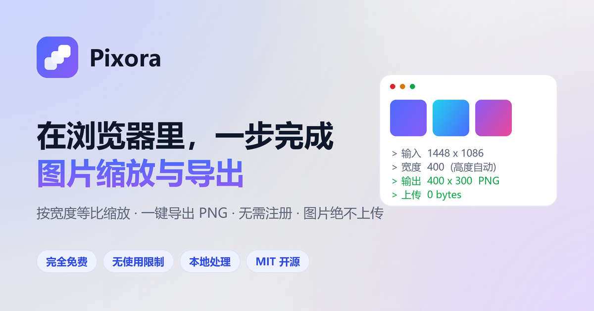

<div align="center">



# Pixora

**浏览器里的免费图片工具箱。按宽度等比缩放，一步完成格式转换。**

无需注册 · 无使用限制 · 图片绝不上传 · MIT 开源

[](https://xuboboo.github.io/pixora/)
[](LICENSE)
[](#技术栈)
[](#性能与-seo)
[](CONTRIBUTING.md)

[在线体验](https://xuboboo.github.io/pixora/) · [功能](#功能特性) · [格式](#支持的格式) · [技术栈](#技术栈) · [SEO 策略](#性能与-seo) · [本地运行](#本地运行) · [贡献](#参与贡献)

</div>

---

## 这是什么

Pixora 把「打开在线 PS → 上传图片 → 文件 → 导出为 PNG → 手动填宽度 → 保存」这一串操作，压缩成**一次拖拽**。

你只需要拖入图片、选一个宽度（比如 400 或 600），高度会**自动按原图比例**换算，然后直接下载。

想转格式也一样简单 —— 把输出格式从 PNG 换成 JPG / WEBP / BMP / ICO 即可，
浏览器支持时还会自动多出 AVIF。整个过程在浏览器内完成，**图片不会上传到任何服务器**。

它不做臃肿的全能编辑器 —— 只把最高频的「改尺寸 + 转格式 + 导出」做到一步到位。

> **和 Convertio 这类在线转换器的区别**：Convertio 把文件上传到服务器转换，再下载回来。
> Pixora 用的是浏览器自带的图像编解码能力，**文件从头到尾没有离开你的设备** ——
> 因此没有上传等待、没有排队、没有文件保留策略、断网后依然可用。

## 功能特性

| 能力 | 说明 |
| --- | --- |
| **按宽度等比缩放** | 指定宽度（400 / 600 / 自定义），高度自动按原图比例计算，永不变形 |
| **按比例缩放** | 一键 `25% / 50% / 75% / 100%`，批量时按每张图自身像素换算，不同尺寸可一起处理 |
| **不放大** | 目标尺寸超过原图时按轴钳制回原尺寸，避免把小图放大成一团模糊 |
| **格式转换** | 输出 PNG / JPG / WEBP / BMP / ICO，浏览器支持时自动多出 AVIF，非无损格式可调质量 |
| **批量处理** | 一次拖入多张图片，统一套用设置，逐张输出结果与下载链接 |
| **打包下载 ZIP** | 批量结果一键打包，ZIP 结构由页面内手写实现，不依赖任何压缩库 |
| **透明背景处理** | 目标格式不支持透明（JPG / BMP）时，可指定背景填充色，避免出现黑块 |
| **三种缩放模式** | 等比适应（不变形）、拉伸填满、等比填充（居中裁剪） |
| **体积变化提示** | 每张结果卡片显示相对原图的体积变化，如 `↓29%` / `↑679%` |
| **本次会话统计** | 结果区汇总本次处理的张数、原始体积、输出体积与减少百分比 |
| **设置重转** | 改完设置不必重新拖图，直接对已有结果按新设置重跑 |
| **35 个格式专属页** | 每种转换组合都有独立页面，输出格式已预设，从导航一处可达 |
| **隐私优先** | 解码 / 缩放 / 编码全部在本地完成，无上传、无存储、无追踪 |
| **零依赖** | 纯手写 HTML / CSS / JavaScript，无框架、无构建、无第三方库 |
| **专业级画质** | 分步降采样 + 高质量重采样，大幅缩小时依旧锐利 |
| **离线可用** | 页面加载后断网也能继续处理 |
| **明暗双主题** | 跟随系统偏好，也可手动切换并记忆 |
| **粘贴即用** | 支持 `Ctrl` + `V` 直接粘贴剪贴板截图 |
| **全设备适配** | 320px 手机到 2560px 宽屏共 18 个断点零横向溢出，触摸目标 ≥44px |

## 怎么找到想要的转换

格式矩阵距页面顶部只有**一次交互**：

| 入口 | 位置 | 覆盖范围 |
| --- | --- | --- |
| 导航「格式转换 ▾」 | 全站每个页面的页头 | 35 个转换页 + 总览页，按输出格式分 5 组 |
| 「直接按格式转换」快捷行 | 首页工具区上方 | 6 个热门组合 + 全部 35 种 |
| 「全部 35 种转换组合」索引 | 首页 `#conversions` | 全部 35 条，按输出格式分组 |
| 页脚「全部格式转换」 | 页脚产品列 | 总览页 |

这套信息架构来自对 iLoveIMG、Convertio、CloudConvert 三家的逆向分析，
结论与取舍见 [`docs/竞品入口与信息架构逆向分析.md`](docs/竞品入口与信息架构逆向分析.md)。

## 支持的格式

### 输出格式

| 格式 | 透明通道 | 质量滑块 | 编码方式 | 适用场景 |
| --- | :---: | :---: | --- | --- |
| **PNG** | ✅ | — | Canvas `toBlob` | 无损压缩、截图、需要反复编辑的素材 |
| **JPG** | ❌ | ✅ | Canvas `toBlob` | 照片类图片，兼容性最好、体积小 |
| **WEBP** | ✅ | ✅ | Canvas `toBlob` | 比 JPG 再小约 25%，现代浏览器全支持 |
| **AVIF** | ✅ | ✅ | Canvas `toBlob`（条件可用） | 同画质体积最小；多数浏览器只能解码、不能编码，故做运行时探测 |
| **BMP** | ❌ | — | **页面内手写编码器** | 无压缩位图，任何软件都能打开，体积明显偏大 |
| **ICO** | ✅ | — | **页面内手写编码器** | 网站图标，最长边自动限制 256px，预设自动切为图标尺寸 |

> 下拉框里出现哪些格式，由**运行时能力探测**决定：页面会实际编码一遍并校验返回 blob 的 MIME，
> 只有真正可用的才列出来。宁可少列，也不给一个点了会失败的选项。

### 输入格式

凡是浏览器能解码的图片都能拖进来：PNG、JPG、WEBP、GIF、BMP、AVIF、SVG、ICO 等。
转换全程不联网。

### 为什么只有这几种

另外一百多种格式（HEIC、CR2、NEF、PSD、AI、EPS…）都要靠服务端解码器。
Pixora 的前提是**图片不上传**，因此不会为了凑格式数量而引入服务器 ——
这也是它与 Convertio 这类上传式转换器最本质的区别。


## 截图

<div align="center">

</div>

## 技术栈

Pixora 刻意保持极简 —— **没有 `package.json`，没有构建步骤，没有依赖**。

- **标记**：语义化 HTML5（`header` / `nav` / `main` / `section` / `article` / `footer`）
- **样式**：原生 CSS3 —— 自定义属性（Design Tokens）、`color-mix()`、Grid、`clamp()` 流体排版、`prefers-color-scheme` / `prefers-reduced-motion`
- **脚本**：原生 ES2017+（`async/await`、`createImageBitmap`、`IntersectionObserver`），无任何运行时依赖
- **图像引擎**：`createImageBitmap` → `OffscreenCanvas`/`Canvas` → 分步降采样 → `toBlob` 编码
- **自研编码器**：BMP（BITMAPFILEHEADER + 24-bit BGR 自底向上 + 4 字节行对齐）、
  ICO（ICONDIR + 内嵌 PNG）、ZIP（Local File Header + Central Directory + EOCD，CRC32 查表，
  优先 `CompressionStream("deflate-raw")`，不可用时降级为 store 模式）
- **托管**：GitHub Pages（静态，无需服务器）

```
pixora/
├── index.html                     # 单页官网 + 在线工具
├── convert/                       # 格式转换落地页矩阵（生成产物，勿手改）
│   ├── index.html                 # 全部格式转换总览
│   └── <from>-to-<to>/index.html  # 35 个转换页，每个都内嵌可用的转换器
├── tools/
│   └── gen-convert-pages.mjs      # 落地页 + sitemap.xml 生成器
├── assets/
│   ├── css/style.css              # 设计系统（Design Tokens + 组件）
│   ├── js/main.js                 # 主题、导航、动效、图像引擎
│   └── img/
│       ├── logo.svg               # 主标志
│       ├── logo-mono.svg          # 单色标志
│       ├── logo-lockup.svg        # 标志组合（含字标）
│       ├── favicon.svg            # 矢量站点图标
│       ├── favicon-32.png         # 位图回退
│       ├── apple-touch-icon.png   # iOS 主屏图标
│       ├── icon-192.png           # PWA 图标
│       ├── icon-512.png           # PWA 图标
│       ├── icon-maskable-512.png  # PWA 自适应图标
│       └── og.png                 # 1200×630 社交分享图
├── robots.txt                     # 抓取策略（含 AI 爬虫显式放行）
├── sitemap.xml                    # 站点地图（由生成器写入，37 条）
├── site.webmanifest               # PWA 清单
├── feed.xml                       # RSS 2.0 订阅
├── llms.txt                       # 面向大模型的可读站点摘要
├── humans.txt                     # 站点与作者信息
├── docs/
│   ├── convertio-逆向分析报告.md        # 竞品逆向分析（1.1.0 格式矩阵的参考依据）
│   └── 竞品入口与信息架构逆向分析.md    # iLoveIMG / Convertio / CloudConvert 入口对比（1.2.0 依据）
├── 8f3a1c9e7b2d4f60a5c8e1b93d7f2046.txt  # IndexNow 密钥
├── .well-known/security.txt       # 安全联系信息
├── .nojekyll                      # 关闭 GitHub Pages 的 Jekyll 处理
├── LICENSE                        # MIT 许可证
├── CONTRIBUTING.md                # 贡献指南
├── CODE_OF_CONDUCT.md             # 贡献者公约 · 行为准则
├── SECURITY.md                    # 安全政策与漏洞报告流程
└── CHANGELOG.md                   # 更新日志
```

`convert/` 与 `sitemap.xml` 是生成产物。改内容请改 `tools/gen-convert-pages.mjs`，
然后运行：

```bash
node tools/gen-convert-pages.mjs
```

生成器同时负责三件事：写入 35 个落地页与总览页、重写 `sitemap.xml`、
以及通过 `<!-- NAV:START/END -->` 与 `<!-- FMTINDEX:START/END -->` 标记
把页头导航与首页格式索引同步进 `index.html`。**这两块不要手改**——
导航在 37 个页面里必须一致，任何一处手改都会让它们开始漂移。

## 性能与 SEO

Pixora 的 SEO 不是「加几个 meta 标签」，而是**从渲染路径到结构化数据全链路设计**。

### 1. 抓取与索引

- `robots.txt`：全站放行，**显式放行 AI 爬虫**（GPTBot、ClaudeBot、PerplexityBot、Google-Extended、Applebot-Extended 等）
- `sitemap.xml`：包含 `image` / `xhtml` 命名空间，标注 `lastmod` / `changefreq` / `priority`
- `<link rel="canonical">` + `hreflang`（`zh-CN` / `x-default`）
- `max-image-preview:large` + `max-snippet:-1` —— 允许富媒体摘要与完整摘要
- **IndexNow** 密钥文件 —— 支持 Bing / Yandex 即时索引
- **`llms.txt`** —— 新兴的 AI 可读站点摘要标准，让大模型准确引用

### 2. 结构化数据（JSON-LD `@graph`）

单个 `@graph` 中互相引用，语义完整、无重复：

- `WebSite` → `Organization` → `WebPage` → `SoftwareApplication`（`featureList` 7 项）
- `ImageObject`（OG 图，含 `width`/`height`/`caption`）
- `HowTo`（三步工作流：拖入 → 选格式与宽度 → 下载或打包，可直接竞争富结果）
- `FAQPage`（7 条问答富结果，与页面可见文案一一对应）

> 刻意**不写** `aggregateRating`：没有真实评价就不编造评分，避免被判定为垃圾结构化数据。

### 3. 社交与分享

- Open Graph 完整字段（`og:image:width` / `height` / `alt`、`og:locale`、`og:site_name`）
- Twitter / X `summary_large_image`
- 自绘 1200×630 OG 图

### 4. 前沿技术

- **Speculation Rules API** —— 声明式预渲染 / 预取，让站内跳转接近瞬时
- **PWA** —— `site.webmanifest` + 普通图标 + `maskable` 自适应图标 + 快捷方式
- **`.well-known/security.txt`** —— 安全研究者联系规范
- **流体排版 `clamp()`**、`content-visibility` 友好结构、无渲染阻塞资源

### 5. 格式长尾页矩阵

对 [Convertio](https://convertio.co/zh/image-converter/) 的逆向分析显示，它真正的护城河不是转换器，
而是 **116 个按格式拆分的落地页** —— 覆盖「png 转 jpg」「webp 转 png」这类长尾查询。

Pixora 复刻了这个结构，但只列**真正能完成的组合**：8 种可解码输入 × 5 种可编码输出，
去掉 5 组同格式自转，共 **35 个转换页 + 1 个总览页**。

与「门页」的区别在于每一页都是**能用的**：

- 页面内嵌完整转换器，通过 `<html data-convert-to="jpeg">` 预配置输出格式
- 深链同样可用：`/?to=jpg&w=800` 会带着格式与宽度进入工具
- 每页有独立的 `title` / `description` / `canonical`（36 个页面全部唯一，已脚本校验）
- 每页带 `FAQPage` + `HowTo` + `BreadcrumbList`，且 schema 条目数与页面可见条目数一致
- 相关转换区块按「同输入」「同输出」两个方向互链，任意两页最多两跳可达

> Convertio 的结构化数据只有 `Product` + `AggregateRating`，缺 `FAQPage` / `HowTo` / `SoftwareApplication` —— 这是 Pixora 明确领先的地方。

### 6. 性能预算

| 指标 | 目标 | 实现方式 |
| --- | --- | --- |
| 第三方请求 | **0** | 无 CDN、无字体服务、无分析脚本 |
| 阻塞渲染资源 | **1**（同源 CSS） | 脚本全部 `defer`，无内联大脚本 |
| 布局偏移（CLS） | **≈ 0** | 图片均带 `width`/`height`，无动态注入的广告位 |
| 首屏图片 | 预加载 | `<link rel="preload">` + `fetchpriority="high"` |
| 动效 | 尊重偏好 | `prefers-reduced-motion` 全量降级 |

## 本地运行

无需安装任何东西 —— 这是一个纯静态站点。

```bash
# 方式一：直接打开
# 双击 index.html 即可（部分浏览器对本地 file:// 的剪贴板有限制）

# 方式二：起一个静态服务器（推荐）
python -m http.server 8080
# 然后访问 http://localhost:8080

# 或者
npx serve .
```

## 部署

站点托管在 **GitHub Pages**，从 `main` 分支根目录直接发布：

- 线上地址：<https://xuboboo.github.io/pixora/>
- 仓库设置：`Settings → Pages → Source: Deploy from a branch → main / (root)`

`.nojekyll` 用于关闭 Jekyll 处理，保证 `.well-known/` 等目录被原样发布。

## 浏览器支持

| 浏览器 | 版本 |
| --- | --- |
| Chrome / Edge | 90+ |
| Firefox | 90+ |
| Safari | 15+ |
| 移动端 Chrome / Safari | 15+ |

核心依赖 `createImageBitmap`、`Canvas 2D`、`toBlob`、CSS 自定义属性。

**格式支持差异**：PNG / JPG / BMP / ICO 在所有目标浏览器上都可导出（BMP、ICO 由页面内编码器生成，
不依赖浏览器）。WEBP 编码需要 Chrome 32+ / Firefox 96+ / Safari 16+。
**AVIF 编码**支持度远低于解码支持度 —— 多数浏览器能显示 AVIF 但无法导出 AVIF，
因此 Pixora 对 AVIF 采用运行时探测而非无条件列出。

## 参与贡献

欢迎任何形式的贡献 —— 见 [CONTRIBUTING.md](CONTRIBUTING.md)。特别欢迎：

- 新的图片处理能力（裁剪、旋转、水印、压缩）
- 更多**端上可实现的格式编码器**（如 QOI、TGA、PPM）
- 无障碍与国际化改进
- 性能与算法优化

参与本项目即表示你同意遵守 [行为准则](CODE_OF_CONDUCT.md)。
发现安全问题时，请按 [安全政策](SECURITY.md) 私下报告，不要开公开 Issue。

## 许可证

[MIT](LICENSE) © Pixora contributors

---

<div align="center">
<sub>Pixora 与 Adobe Photoshop®、Photopea、LogoSC 无任何关联。所有商标归其各自所有者。</sub>
</div>
